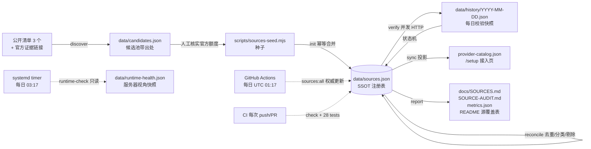

# 维护手册：免费源如何被持续发现、验证、去重、更新与剔除

> 适用版本 v6.0.0 · 最后更新 2026-11-12
> 本文讲「源数据怎么活下来」，运行时路由/熔断/凭据见 [ARCHITECTURE.md](ARCHITECTURE.md) 与 README。

## 1. 数据流



**双视角原则**：仓库/CI 是 `sources.json` 状态的唯一权威；生产服务器只做只读复核，
写独立的 `runtime-health.json`，**不回写注册表、不重生成目录、不刷新文档**。
原因是服务器出网受限（实测 `raw.githubusercontent.com` 返回 000、`ai.google.dev` 不可达），
若让它跑完整 `all`，「本机连不上」会被误记成「源已失效」，与 CI 数据打架。

**SSOT 原则**：`data/sources.json` 是唯一事实来源。两份清单（56 个路由槽位 / 62 个目录条目）不再各自手维护，运行时 `config.json` 仍独立管理路由链，通过 `relayIds` 与注册表建立映射。

## 2. 六个阶段

| 阶段 | 命令 | 输入 | 输出 | 判据 |
|---|---|---|---|---|
| 发现 | `npm run sources:discover` | `data/discovery-feeds.json` | `data/candidates.json` | 候选带 feed URL、license、抓取时间；`disposition` = known / new / rejected |
| 校验 | `npm run sources:verify` | registry | 每日快照 + verification 字段 | 并发 8、超时 10s；docs→pricing→key→endpoint 依次回退；401/403/405/429 算在线 |
| 去重 | `npm run sources:reconcile` | registry | 合并后的 registry | id / 名称别名 / 显式别名三键；不按 host 合并不同计划 |
| 分类 | 同上 | `sources-policy.json` | `category` + `tags` | 8 类，自动补 `auth:` / `region:` / `needs-verification` 标签 |
| 状态与剔除 | 同上 | verification 历史 | `status` + 墓碑 | 连续 2/3 次失败降级/停用，14 天老化，30 天剔除；剔除不删记录 |
| 同步与报告 | `npm run sources:sync` / `report` | registry | catalog + 4 份文档 + metrics | `provider-catalog.json` 保持原 9 字段兼容，额外字段被 router.js 忽略 |

一键全流程：`npm run sources:all`。

## 3. 每日调度

| 位置 | 触发 | 作用 | 失败处理 |
|---|---|---|---|
| `.github/workflows/sources.yml` | cron `17 1 * * *` UTC + 手动 | **权威更新**：跑全流程，`git commit/push` 每日刷新注册表与文档 | 可达率 < 50% 时拒绝提交，避免一次网络故障污染清单 |
| `.github/workflows/ci.yml` | push / PR / 手动 | `npm run check`、28 个测试、版本一致性、schema、文档完整性 | 任一失败即阻断合并 |
| `systemd/ai-relay-sources.timer` | 每日 03:17（服务器本地时区） | **只读复核**：`runtime-check` 写 `data/runtime-health.json`，日志 `logs/sources.log` | 不改注册表/目录/文档，**不重启 relay**、不改 `config.json` |
| `systemd/ai-relay-score.timer` | 每日 09:00 | 运行时上游评分（v6.0.0 修复 401 后真正生效） | 见 `score-run.sh` |

服务器部署后确认：

```bash
systemctl list-timers 'ai-relay-*' --no-pager
systemctl status ai-relay-sources.service --no-pager
tail -50 /opt/ai-relay/logs/sources.log
cat /opt/ai-relay/data/runtime-health.json | head -20     # 服务器视角可达率
```

发现源统一走 `api.github.com/repos/<owner>/<repo>/contents/README.md` + `Accept: application/vnd.github.raw`：
101 服务器直连 `raw.githubusercontent.com` 返回 000，而 `api.github.com` 返回 200；CI 与服务器共用同一端点，
未认证限额 60 次/小时足够（每日 3 个清单 × 1 次）。

## 4. 状态机

```text
                ┌──────────── 成功且 confidence≠community ───────────┐
                ▼                                                     │
  [unverified] ─► active ──连续 2 次失败──► degraded ──连续 3 次──► deprecated
       ▲                                      │                        │
       │                                      └────── 成功 ─────────────┤
       │                                                               ▼
  confidence=community                              14 天老化 / 30 天不可用 ─► removed（墓碑，不自动恢复）
```

`removed` 只置状态与 `removedReason`，条目保留在注册表与 `docs/SOURCES.md` 的「已剔除」章节，保证可追溯。

## 5. 证据与置信度

| confidence | 含义 | 能否进路由 |
|---|---|---|
| `official` | 厂商官方文档/定价/控制台已核实额度 | 可（还需 `status=active`） |
| `aggregator` | 仅公开清单佐证，额度可能滞后 | 可，但 `note` 需标明波动 |
| `community` | 社区汇总数字，未在官方页复核 | **不可**，保持 `unverified`，只作线索 |

每条 `evidence[]` 带 `kind`（official / aggregator-list / project-audit / community-report）与 `retrievedAt`。`docs/SOURCES.md` 按类分组逐条展示出处链接与最后核查时间。

## 6. 变更与回滚

- 每次发现、校验、去重、剔除、目录同步都写入 `data/audit-log.json`，渲染为 `docs/SOURCE-AUDIT.md`。
- 每日校验快照在 `data/history/`，可对比任意两天的可达率与状态迁移。
- 回滚注册表：`git checkout <commit> -- data/sources.json provider-catalog.json docs/SOURCES.md` 后重跑 `npm run sources:report`。
- 线上部署回滚：`deploy.sh` 会自动备份到 `/opt/ai-relay/backups/<timestamp>/`，健康检查失败自动还原；源管道文件是新增文件，回滚时不删除、不影响 relay 运行。

## 7. 服务器约束（重要）

| 约束 | 原因 |
|---|---|
| 源维护脚本不重启 relay | 线上服务 39 天连续运行，源数据刷新不需要重启 |
| 不覆盖 `token` / `secrets/` / `state/` / `logs/` | `deploy.sh` 用 tar 只同步 `scripts/` `data/` `docs/` |
| `data/` 里的 history 与 audit 可被本机版本覆盖 | 它们是追加型证据，以仓库为准；线上不产生需要保留的独立状态 |
| 私钥/token 不进命令行 | `score-run.sh` 用 `curl --config -` 从 stdin 传 header |
| 探测只发 GET，不携带凭据 | 只验证端点可达性与文档有效性，不消耗账号额度 |

## 8. 故障排查

| 现象 | 检查 | 处理 |
|---|---|---|
| 可达率骤降 | `data/history/<date>.json` 里 `unreachable` 的错误 | 多为本机/服务器出网抖动；CI 有 <50% 拒绝提交保护，先手动重跑 `sources:verify` |
| 某源文档 404 | `evidence[0].url` | 更新官方 URL 到种子；脚本会回退到 pricing/key/endpoint，不会立刻判死 |
| 目录条目数下降 | `data/audit-log.json` 的 `catalog-sync` | 检查是否有源被置 `removed`；墓碑章节保留原因 |
| 每日提交没出现 | GitHub Actions `sources` workflow 日志 | 可能无变更（`git diff --cached --quiet`），或 cron 被 GitHub 延迟；可 workflow_dispatch 手动跑 |
| 服务器 timer 没跑 | `journalctl -u ai-relay-sources.service` | 确认 `/opt/ai-relay/scripts/sources-cron.sh` 存在且可执行、Node ≥ 20 |
| 公开清单抓取全失败 | `data/discovery-feeds.json` 的 `url` | 必须用 `api.github.com/.../contents/README.md`；`raw.githubusercontent.com` 在部分机房被断 |
| 服务器可达率明显低于仓库 | `data/runtime-health.json` 的 `unreachable` | 属正常（本机出网视角），**以 CI 权威注册表为准**，不要用服务器结果剔除源 |
| 评分面板仍为空 | `journalctl -u ai-relay-score.service` | v6.0.0 前的 401 已修；确认 `state/scores.json` 生成、`/api/score/run` 返回 200 |

## 9. 已知边界

- 端点可达 ≠ 账号有额度。带 key 的真实可用性由 `/setup` 保存 key 时的 authenticated model-list 校验负责。
- `config.json` 的 `dailyLimit` 仍未启用，运行时每日限额是空转；额度事实已在注册表，灰度启用留待独立版本。
- 自动发现只解析公开清单的标题级条目，不解析表格内的逐模型限额；逐模型限额仍以厂商官方页为准。
